# 实验结果汇总

## GSM8K(n = 100)

| 方法 | 准确率 | 95% CI | 平均调用次数 | 平均 token | 平均输出 token | 平均耗时(s) | 截断率 |
|---|---|---|---|---|---|---|---|
| Single | 45.0% | ±9.8 | 1.0 | 112 | 6 | 1.4 | 0.0% |
| CoT | 93.0% | ±5.0 | 1.0 | 583 | 465 | 9.5 | 0.0% |
| SC@3 | 92.0% | ±5.3 | 3.0 | 1836 | 1484 | 35.7 | 0.0% |
| SC@6 | 95.0% | ±4.3 | 6.0 | 3669 | 2965 | 68.0 | 0.0% |
| Debate 3x1 | 95.0% | ±4.3 | 3.0 | 1764 | 1430 | 52.8 | 0.0% |
| Debate 3x2 | 94.0% | ±4.7 | 6.0 | 8211 | 2774 | 112.2 | 0.0% |
| Debate 3x3 | 95.0% | ±4.3 | 9.0 | 19128 | 4078 | 173.4 | 0.0% |
| Debate 3x3 +Judge | 94.0% | ±4.7 | 10.0 | 21225 | 4682 | 198.2 | 0.0% |
| Debate DynStop | 95.0% | ±4.3 | 3.2 | 2627 | 1574 | 59.5 | 0.0% |
| Roles 3x1 | 95.0% | ±4.3 | 3.0 | 2133 | 1602 | 66.4 | 0.0% |
| Roles 3x2 | 94.0% | ±4.7 | 6.0 | 9843 | 3381 | 151.0 | 0.0% |
| Roles 3x3 | 95.0% | ±4.3 | 9.0 | 23490 | 5168 | 234.4 | 0.0% |
| Roles 3x3 ConfVote | 95.0% | ±4.3 | 9.0 | 23490 | 5168 | 234.4 | 0.0% |
| Roles 3x3 +Judge | 94.0% | ±4.7 | 10.0 | 26116 | 5818 | 262.1 | 0.0% |
| Roles DynStop | 95.0% | ±4.3 | 3.2 | 3079 | 1795 | 79.6 | 0.0% |
| AntiConf 3x1 | 92.0% | ±5.3 | 3.0 | 2015 | 1581 | 67.9 | 0.0% |
| AntiConf 3x2 | 93.0% | ±5.0 | 6.0 | 9629 | 3276 | 148.0 | 0.0% |
| AntiConf 3x3 | 93.0% | ±5.0 | 9.0 | 23010 | 4911 | 224.0 | 0.0% |
| AntiConf 3x3 ConfVote | 93.0% | ±5.0 | 9.0 | 23010 | 4911 | 224.0 | 0.0% |
| AntiConf 3x3 +Judge | 93.0% | ±5.0 | 10.0 | 25473 | 5550 | 251.4 | 0.0% |
| AntiConf DynStop | 93.0% | ±5.0 | 3.3 | 3974 | 1845 | 84.5 | 0.0% |

**显著性(精确 McNemar 检验)**

| A vs B | 仅 A 对 | 仅 B 对 | p 值 |
|---|---|---|---|
| Debate 3x3 vs SC@6 | 1 | 1 | 1.000 |
| Debate 3x2 vs SC@6 | 1 | 2 | 1.000 |
| Debate 3x3 vs CoT | 3 | 1 | 0.625 |
| Debate 3x3 +Judge vs Debate 3x3 | 0 | 1 | 1.000 |
| Roles 3x3 vs Debate 3x3 | 0 | 0 | 1.000 |
| Roles 3x3 ConfVote vs Roles 3x3 | 0 | 0 | 1.000 |
| AntiConf 3x3 vs Debate 3x3 | 0 | 2 | 0.500 |
| AntiConf 3x3 ConfVote vs AntiConf 3x3 | 0 | 0 | 1.000 |
| Debate DynStop vs Debate 3x3 | 0 | 0 | 1.000 |
| Debate DynStop vs SC@6 | 1 | 1 | 1.000 |
| Roles 3x3 vs SC@6 | 1 | 1 | 1.000 |
| AntiConf 3x3 vs SC@6 | 0 | 2 | 0.500 |
| Roles 3x3 ConfVote vs Debate 3x3 | 0 | 0 | 1.000 |

**裁判 agent vs 多数投票**(只看裁判结论与多数投票不同的题)

| 裁判变体 | 准确率 | 对应多数投票 | 准确率 | 推翻多数 | 推翻后改对 | 推翻后改错 | 额外 token |
|---|---|---|---|---|---|---|---|
| Debate 3x3 +Judge | 94.0% | Debate 3x3 | 95.0% | 1 | 0 | 1 | 2097 |
| Roles 3x3 +Judge | 94.0% | Roles 3x3 | 95.0% | 1 | 0 | 1 | 2626 |
| AntiConf 3x3 +Judge | 93.0% | AntiConf 3x3 | 93.0% | 0 | 0 | 0 | 2463 |

**动态终止**(全员一致即提前停止)

- Debate: 准确率 95.0% → 95.0%,token 19128 → 2627(节省 86%)
- Roles: 准确率 95.0% → 95.0%,token 23490 → 3079(节省 87%)
- AntiConf: 准确率 93.0% → 93.0%,token 23010 → 3974(节省 83%)

**从众 / 纠错分析**(逐 agent 答案迁移,所有轮次累计)

| 辩论版本 | 错→对 | 对→错 | 改答案比例 | 最终全票一致率 | 全票一致但错 | 首轮有人对但最终多数错 |
|---|---|---|---|---|---|---|
| Debate | 6 | 4 | 1.7% | 99.0% | 5 | 1 |
| Roles | 5 | 3 | 1.3% | 99.0% | 5 | 1 |
| AntiConf | 6 | 3 | 1.5% | 100.0% | 7 | 2 |

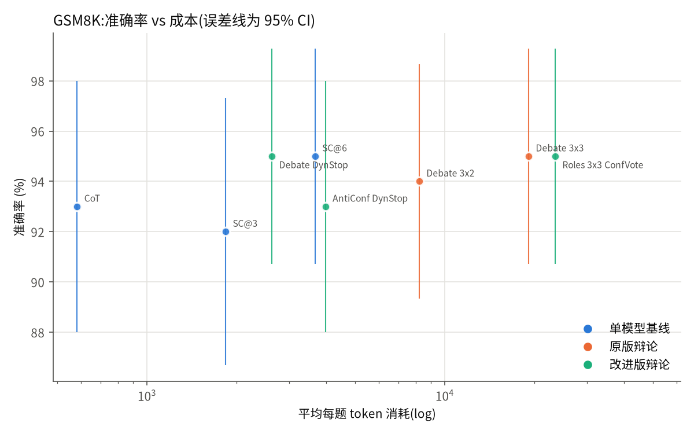
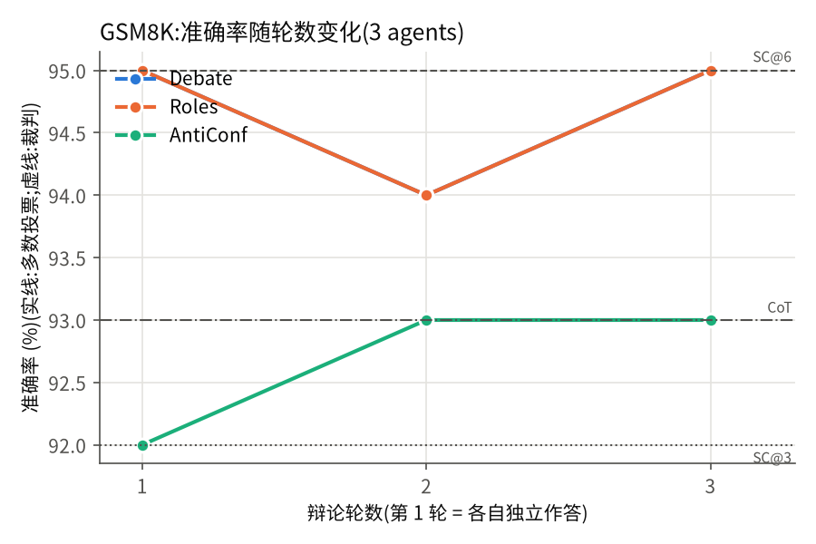
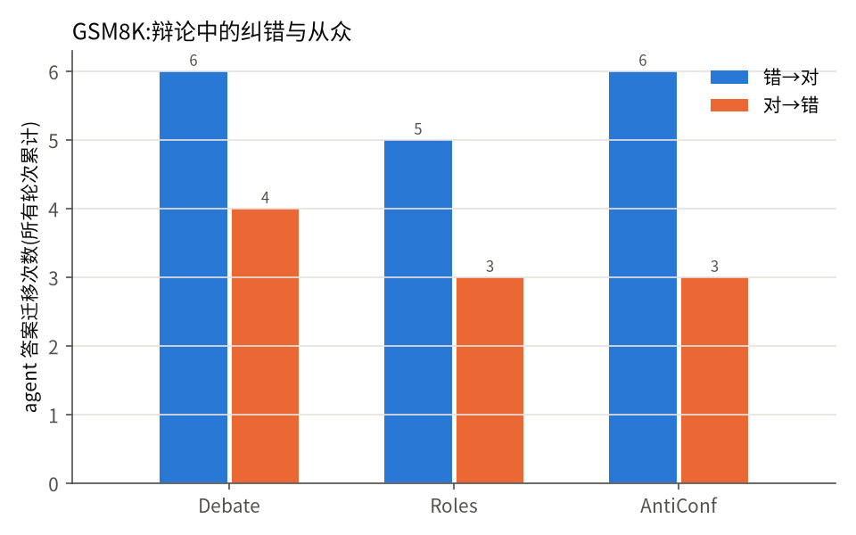

## MATH(n = 156)

| 方法 | 准确率 | 95% CI | 平均调用次数 | 平均 token | 平均输出 token | 平均耗时(s) | 截断率 |
|---|---|---|---|---|---|---|---|
| Single | 19.9% | ±6.3 | 1.0 | 132 | 5 | 0.8 | 0.6% |
| CoT | 98.7% | ±1.8 | 1.0 | 1861 | 1723 | 38.5 | 0.0% |
| SC@3 | 100.0% | ±0.0 | 3.0 | 5619 | 5204 | 135.0 | 0.0% |
| SC@6 | 100.0% | ±0.0 | 6.0 | 11246 | 10417 | 276.7 | 0.0% |
| Debate 3x1 | 99.4% | ±1.3 | 3.0 | 5426 | 5030 | 241.7 | 0.0% |
| Debate 3x2 | 100.0% | ±0.0 | 6.0 | 24741 | 8318 | 420.0 | 0.0% |
| Debate 3x3 | 100.0% | ±0.0 | 9.0 | 54508 | 11654 | 630.1 | 0.0% |
| Debate 3x3 +Judge | 99.4% | ±1.3 | 10.0 | 59293 | 12893 | 696.7 | 0.0% |
| Debate DynStop | 100.0% | ±0.0 | 3.1 | 6893 | 5224 | 249.4 | 0.0% |
| Roles 3x1 | 100.0% | ±0.0 | 3.0 | 6206 | 5612 | 296.4 | 0.0% |
| Roles 3x2 | 99.4% | ±1.3 | 6.0 | 27957 | 9278 | 486.9 | 0.0% |
| Roles 3x3 | 99.4% | ±1.3 | 9.0 | 61282 | 12867 | 681.7 | 0.0% |
| Roles 3x3 ConfVote | 99.4% | ±1.3 | 9.0 | 61282 | 12867 | 681.7 | 0.0% |
| Roles 3x3 +Judge | 100.0% | ±0.0 | 10.0 | 66288 | 14074 | 745.7 | 0.0% |
| Roles DynStop | 99.4% | ±1.3 | 3.2 | 9633 | 6003 | 310.5 | 0.0% |
| AntiConf 3x1 | 99.4% | ±1.3 | 3.0 | 5738 | 5243 | 278.1 | 0.0% |
| AntiConf 3x2 | 99.4% | ±1.3 | 6.0 | 26159 | 8635 | 469.7 | 0.0% |
| AntiConf 3x3 | 99.4% | ±1.3 | 9.0 | 57521 | 11987 | 656.2 | 0.0% |
| AntiConf 3x3 ConfVote | 99.4% | ±1.3 | 9.0 | 57521 | 11987 | 656.2 | 0.0% |
| AntiConf 3x3 +Judge | 99.4% | ±1.3 | 10.0 | 62252 | 13157 | 718.5 | 0.0% |
| AntiConf DynStop | 99.4% | ±1.3 | 3.0 | 6691 | 5319 | 281.4 | 0.0% |

**显著性(精确 McNemar 检验)**

| A vs B | 仅 A 对 | 仅 B 对 | p 值 |
|---|---|---|---|
| Debate 3x3 vs SC@6 | 0 | 0 | 1.000 |
| Debate 3x2 vs SC@6 | 0 | 0 | 1.000 |
| Debate 3x3 vs CoT | 2 | 0 | 0.500 |
| Debate 3x3 +Judge vs Debate 3x3 | 0 | 1 | 1.000 |
| Roles 3x3 vs Debate 3x3 | 0 | 1 | 1.000 |
| Roles 3x3 ConfVote vs Roles 3x3 | 0 | 0 | 1.000 |
| AntiConf 3x3 vs Debate 3x3 | 0 | 1 | 1.000 |
| AntiConf 3x3 ConfVote vs AntiConf 3x3 | 0 | 0 | 1.000 |
| Debate DynStop vs Debate 3x3 | 0 | 0 | 1.000 |
| Debate DynStop vs SC@6 | 0 | 0 | 1.000 |
| Roles 3x3 vs SC@6 | 0 | 1 | 1.000 |
| AntiConf 3x3 vs SC@6 | 0 | 1 | 1.000 |
| Roles 3x3 ConfVote vs Debate 3x3 | 0 | 1 | 1.000 |

**裁判 agent vs 多数投票**(只看裁判结论与多数投票不同的题)

| 裁判变体 | 准确率 | 对应多数投票 | 准确率 | 推翻多数 | 推翻后改对 | 推翻后改错 | 额外 token |
|---|---|---|---|---|---|---|---|
| Debate 3x3 +Judge | 99.4% | Debate 3x3 | 100.0% | 1 | 0 | 1 | 4785 |
| Roles 3x3 +Judge | 100.0% | Roles 3x3 | 99.4% | 1 | 1 | 0 | 5006 |
| AntiConf 3x3 +Judge | 99.4% | AntiConf 3x3 | 99.4% | 0 | 0 | 0 | 4731 |

**动态终止**(全员一致即提前停止)

- Debate: 准确率 100.0% → 100.0%,token 54508 → 6893(节省 87%)
- Roles: 准确率 99.4% → 99.4%,token 61282 → 9633(节省 84%)
- AntiConf: 准确率 99.4% → 99.4%,token 57521 → 6691(节省 88%)

**从众 / 纠错分析**(逐 agent 答案迁移,所有轮次累计)

| 辩论版本 | 错→对 | 对→错 | 改答案比例 | 最终全票一致率 | 全票一致但错 | 首轮有人对但最终多数错 |
|---|---|---|---|---|---|---|
| Debate | 8 | 1 | 1.0% | 99.4% | 0 | 0 |
| Roles | 6 | 2 | 0.9% | 100.0% | 1 | 1 |
| AntiConf | 5 | 3 | 0.9% | 99.4% | 1 | 0 |

**agent 数量消融**(n = 80)

| 配置 | 准确率 | 平均 token |
|---|---|---|
| Debate 3x1 | 98.8% | 6073 |
| Debate 3x2 | 100.0% | 27420 |
| Debate 3x3 | 100.0% | 59585 |
| Debate 1x1 | 97.5% | 2055 |
| Debate 1x2 | 98.8% | 5211 |
| Debate 1x3 | 98.8% | 9329 |
| Debate 5x1 | 100.0% | 9895 |
| Debate 5x2 | 100.0% | 63168 |
| Debate 5x3 | 100.0% | 145779 |

| A vs B | 仅 A 对 | 仅 B 对 | p 值 |
|---|---|---|---|
| Debate 3x3 vs Debate 1x3 | 1 | 0 | 1.000 |
| Debate 5x3 vs Debate 3x3 | 0 | 0 | 1.000 |
| Debate 1x3 vs Debate 1x1 | 1 | 0 | 1.000 |

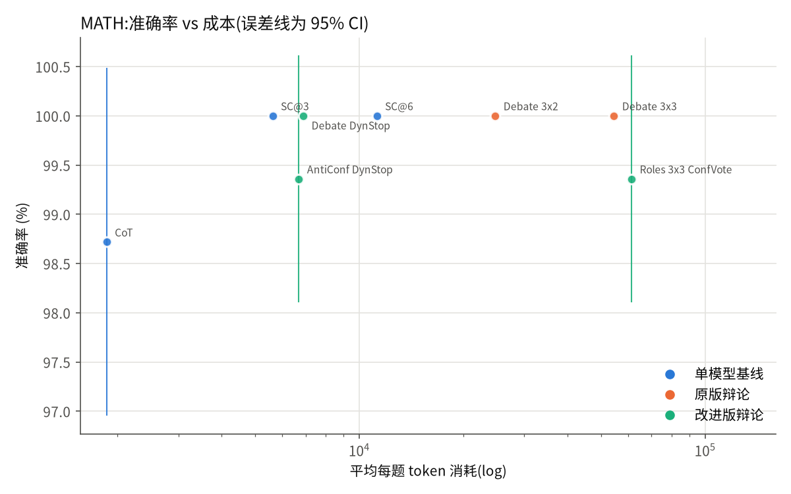
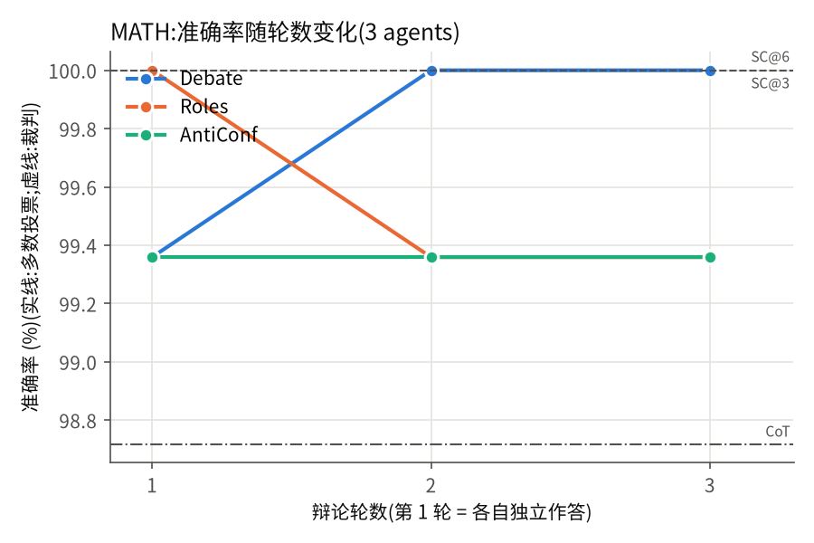
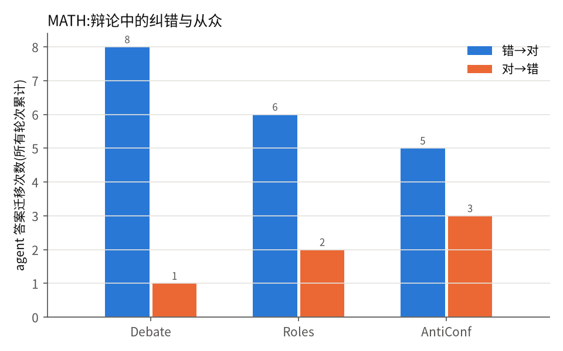
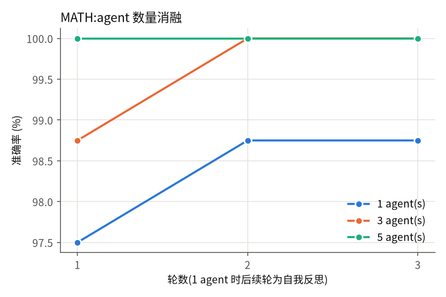

## AIME(n = 2)

| 方法 | 准确率 | 95% CI | 平均调用次数 | 平均 token | 平均输出 token | 平均耗时(s) | 截断率 |
|---|---|---|---|---|---|---|---|
| Single | 0.0% | ±0.0 | 1.0 | 186 | 5 | 11.6 | 0.0% |
| CoT | 100.0% | ±0.0 | 1.0 | 1420 | 1230 | 41.2 | 0.0% |
| SC@3 | 100.0% | ±0.0 | 3.0 | 4815 | 4242 | 91.2 | 0.0% |
| SC@6 | 100.0% | ±0.0 | 6.0 | 11376 | 10230 | 264.5 | 0.0% |
| Debate 3x1 | 100.0% | ±0.0 | 3.0 | 4746 | 4192 | 93.2 | 0.0% |
| Debate 3x2 | 100.0% | ±0.0 | 6.0 | 22286 | 7902 | 375.5 | 0.0% |
| Debate 3x3 | 100.0% | ±0.0 | 9.0 | 51590 | 11546 | 615.3 | 0.0% |
| Debate 3x3 +Judge | 100.0% | ±0.0 | 10.0 | 56812 | 12862 | 697.8 | 0.0% |
| Debate DynStop | 100.0% | ±0.0 | 3.0 | 4746 | 4192 | 93.2 | 0.0% |
| Roles 3x1 | 100.0% | ±0.0 | 3.0 | 5254 | 4502 | 319.9 | 0.0% |
| Roles 3x2 | 100.0% | ±0.0 | 6.0 | 24210 | 8387 | 485.5 | 0.0% |
| Roles 3x3 | 100.0% | ±0.0 | 9.0 | 55698 | 12336 | 589.5 | 0.0% |
| Roles 3x3 ConfVote | 100.0% | ±0.0 | 9.0 | 55698 | 12336 | 589.5 | 0.0% |
| Roles 3x3 +Judge | 100.0% | ±0.0 | 10.0 | 61215 | 13642 | 637.8 | 0.0% |
| Roles DynStop | 100.0% | ±0.0 | 3.0 | 5254 | 4502 | 319.9 | 0.0% |
| AntiConf 3x1 | 100.0% | ±0.0 | 3.0 | 5364 | 4710 | 158.4 | 0.0% |
| AntiConf 3x2 | 100.0% | ±0.0 | 6.0 | 24676 | 8274 | 416.9 | 0.0% |
| AntiConf 3x3 | 100.0% | ±0.0 | 9.0 | 55642 | 11838 | 918.4 | 0.0% |
| AntiConf 3x3 ConfVote | 100.0% | ±0.0 | 9.0 | 55642 | 11838 | 918.4 | 0.0% |
| AntiConf 3x3 +Judge | 100.0% | ±0.0 | 10.0 | 60561 | 12930 | 987.5 | 0.0% |
| AntiConf DynStop | 100.0% | ±0.0 | 3.0 | 5364 | 4710 | 158.4 | 0.0% |

**显著性(精确 McNemar 检验)**

| A vs B | 仅 A 对 | 仅 B 对 | p 值 |
|---|---|---|---|
| Debate 3x3 vs SC@6 | 0 | 0 | 1.000 |
| Debate 3x2 vs SC@6 | 0 | 0 | 1.000 |
| Debate 3x3 vs CoT | 0 | 0 | 1.000 |
| Debate 3x3 +Judge vs Debate 3x3 | 0 | 0 | 1.000 |
| Roles 3x3 vs Debate 3x3 | 0 | 0 | 1.000 |
| Roles 3x3 ConfVote vs Roles 3x3 | 0 | 0 | 1.000 |
| AntiConf 3x3 vs Debate 3x3 | 0 | 0 | 1.000 |
| AntiConf 3x3 ConfVote vs AntiConf 3x3 | 0 | 0 | 1.000 |
| Debate DynStop vs Debate 3x3 | 0 | 0 | 1.000 |
| Debate DynStop vs SC@6 | 0 | 0 | 1.000 |
| Roles 3x3 vs SC@6 | 0 | 0 | 1.000 |
| AntiConf 3x3 vs SC@6 | 0 | 0 | 1.000 |
| Roles 3x3 ConfVote vs Debate 3x3 | 0 | 0 | 1.000 |

**裁判 agent vs 多数投票**(只看裁判结论与多数投票不同的题)

| 裁判变体 | 准确率 | 对应多数投票 | 准确率 | 推翻多数 | 推翻后改对 | 推翻后改错 | 额外 token |
|---|---|---|---|---|---|---|---|
| Debate 3x3 +Judge | 100.0% | Debate 3x3 | 100.0% | 0 | 0 | 0 | 5222 |
| Roles 3x3 +Judge | 100.0% | Roles 3x3 | 100.0% | 0 | 0 | 0 | 5518 |
| AntiConf 3x3 +Judge | 100.0% | AntiConf 3x3 | 100.0% | 0 | 0 | 0 | 4918 |

**动态终止**(全员一致即提前停止)

- Debate: 准确率 100.0% → 100.0%,token 51590 → 4746(节省 91%)
- Roles: 准确率 100.0% → 100.0%,token 55698 → 5254(节省 91%)
- AntiConf: 准确率 100.0% → 100.0%,token 55642 → 5364(节省 90%)

**从众 / 纠错分析**(逐 agent 答案迁移,所有轮次累计)

| 辩论版本 | 错→对 | 对→错 | 改答案比例 | 最终全票一致率 | 全票一致但错 | 首轮有人对但最终多数错 |
|---|---|---|---|---|---|---|
| Debate | 0 | 0 | 0.0% | 100.0% | 0 | 0 |
| Roles | 0 | 0 | 0.0% | 100.0% | 0 | 0 |
| AntiConf | 0 | 0 | 0.0% | 100.0% | 0 | 0 |

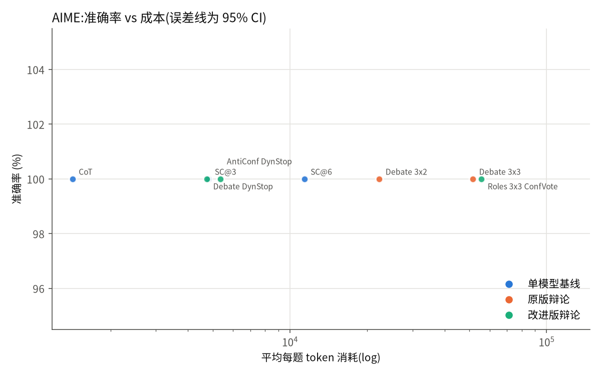
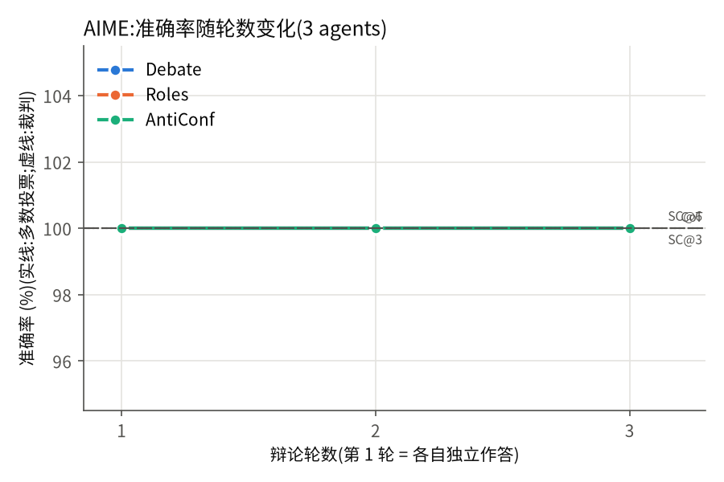
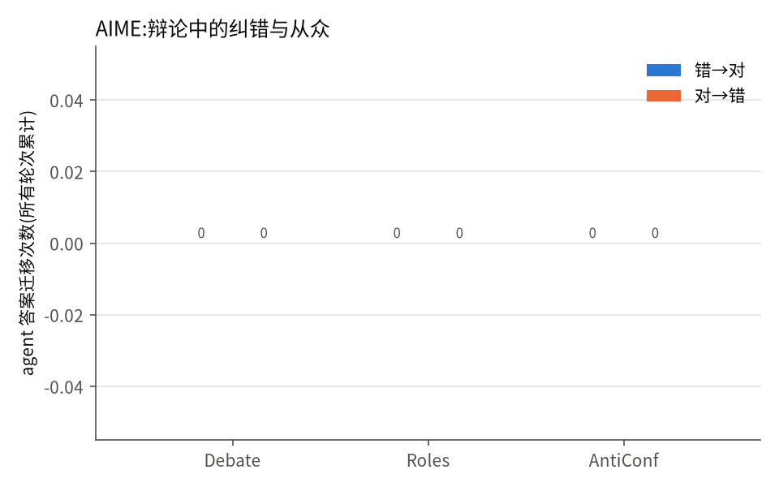

## MMLU(n = 100)

| 方法 | 准确率 | 95% CI | 平均调用次数 | 平均 token | 平均输出 token | 平均耗时(s) | 截断率 |
|---|---|---|---|---|---|---|---|
| Single | 85.0% | ±7.0 | 1.0 | 162 | 20 | 3.7 | 60.0% |
| CoT | 91.0% | ±5.6 | 1.0 | 890 | 735 | 18.9 | 0.0% |
| SC@3 | 92.0% | ±5.3 | 3.0 | 2768 | 2302 | 61.8 | 0.0% |
| SC@6 | 93.0% | ±5.0 | 6.0 | 5490 | 4559 | 121.2 | 0.0% |
| Debate 3x1 | 91.0% | ±5.6 | 3.0 | 2524 | 2076 | 105.6 | 0.0% |
| Debate 3x2 | 92.0% | ±5.3 | 6.0 | 11649 | 3934 | 196.1 | 0.0% |
| Debate 3x3 | 91.0% | ±5.6 | 9.0 | 26940 | 5793 | 280.5 | 0.0% |
| Debate 3x3 +Judge | 92.0% | ±5.3 | 10.0 | 29738 | 6505 | 312.6 | 0.0% |
| Debate DynStop | 91.0% | ±5.6 | 3.3 | 4114 | 2328 | 116.1 | 0.0% |
| Roles 3x1 | 92.0% | ±5.3 | 3.0 | 3172 | 2527 | 132.2 | 0.0% |
| Roles 3x2 | 93.0% | ±5.0 | 6.0 | 14351 | 4775 | 245.6 | 0.0% |
| Roles 3x3 | 92.0% | ±5.3 | 9.0 | 32994 | 7037 | 356.0 | 0.0% |
| Roles 3x3 ConfVote | 92.0% | ±5.3 | 9.0 | 32994 | 7037 | 356.0 | 0.0% |
| Roles 3x3 +Judge | 92.0% | ±5.3 | 10.0 | 36202 | 7758 | 391.4 | 0.0% |
| Roles DynStop | 92.0% | ±5.3 | 3.3 | 5370 | 2895 | 147.8 | 0.0% |
| AntiConf 3x1 | 91.0% | ±5.6 | 3.0 | 2778 | 2232 | 119.3 | 0.3% |
| AntiConf 3x2 | 89.0% | ±6.1 | 6.0 | 13050 | 4406 | 229.4 | 0.2% |
| AntiConf 3x3 | 90.0% | ±5.9 | 9.0 | 30610 | 6491 | 326.0 | 0.1% |
| AntiConf 3x3 ConfVote | 90.0% | ±5.9 | 9.0 | 30610 | 6491 | 326.0 | 0.1% |
| AntiConf 3x3 +Judge | 91.0% | ±5.6 | 10.0 | 33636 | 7206 | 360.4 | 0.1% |
| AntiConf DynStop | 90.0% | ±5.9 | 3.4 | 5611 | 2715 | 140.1 | 0.3% |

**显著性(精确 McNemar 检验)**

| A vs B | 仅 A 对 | 仅 B 对 | p 值 |
|---|---|---|---|
| Debate 3x3 vs SC@6 | 1 | 3 | 0.625 |
| Debate 3x2 vs SC@6 | 2 | 3 | 1.000 |
| Debate 3x3 vs CoT | 3 | 3 | 1.000 |
| Debate 3x3 +Judge vs Debate 3x3 | 1 | 0 | 1.000 |
| Roles 3x3 vs Debate 3x3 | 3 | 2 | 1.000 |
| Roles 3x3 ConfVote vs Roles 3x3 | 0 | 0 | 1.000 |
| AntiConf 3x3 vs Debate 3x3 | 1 | 2 | 1.000 |
| AntiConf 3x3 ConfVote vs AntiConf 3x3 | 0 | 0 | 1.000 |
| Debate DynStop vs Debate 3x3 | 0 | 0 | 1.000 |
| Debate DynStop vs SC@6 | 1 | 3 | 0.625 |
| Roles 3x3 vs SC@6 | 0 | 1 | 1.000 |
| AntiConf 3x3 vs SC@6 | 1 | 4 | 0.375 |
| Roles 3x3 ConfVote vs Debate 3x3 | 3 | 2 | 1.000 |

**裁判 agent vs 多数投票**(只看裁判结论与多数投票不同的题)

| 裁判变体 | 准确率 | 对应多数投票 | 准确率 | 推翻多数 | 推翻后改对 | 推翻后改错 | 额外 token |
|---|---|---|---|---|---|---|---|
| Debate 3x3 +Judge | 92.0% | Debate 3x3 | 91.0% | 1 | 1 | 0 | 2797 |
| Roles 3x3 +Judge | 92.0% | Roles 3x3 | 92.0% | 0 | 0 | 0 | 3209 |
| AntiConf 3x3 +Judge | 91.0% | AntiConf 3x3 | 90.0% | 1 | 1 | 0 | 3026 |

**动态终止**(全员一致即提前停止)

- Debate: 准确率 91.0% → 91.0%,token 26940 → 4114(节省 85%)
- Roles: 准确率 92.0% → 92.0%,token 32994 → 5370(节省 84%)
- AntiConf: 准确率 90.0% → 90.0%,token 30610 → 5611(节省 82%)

**从众 / 纠错分析**(逐 agent 答案迁移,所有轮次累计)

| 辩论版本 | 错→对 | 对→错 | 改答案比例 | 最终全票一致率 | 全票一致但错 | 首轮有人对但最终多数错 |
|---|---|---|---|---|---|---|
| Debate | 9 | 7 | 2.7% | 98.0% | 7 | 3 |
| Roles | 9 | 6 | 3.0% | 97.0% | 7 | 2 |
| AntiConf | 9 | 6 | 2.8% | 97.0% | 8 | 4 |

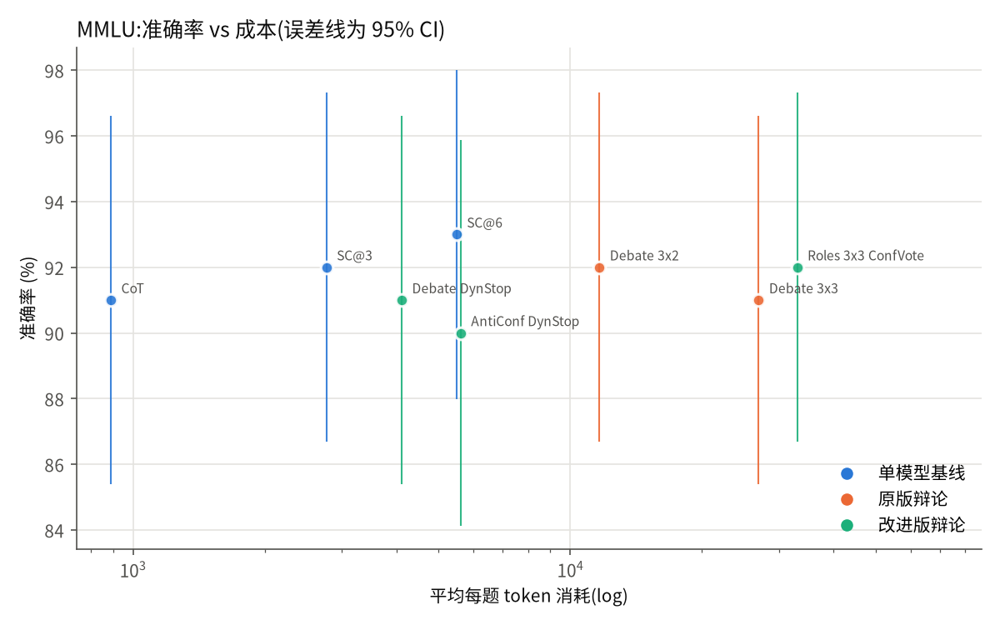
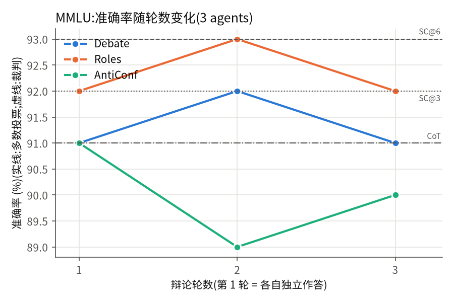
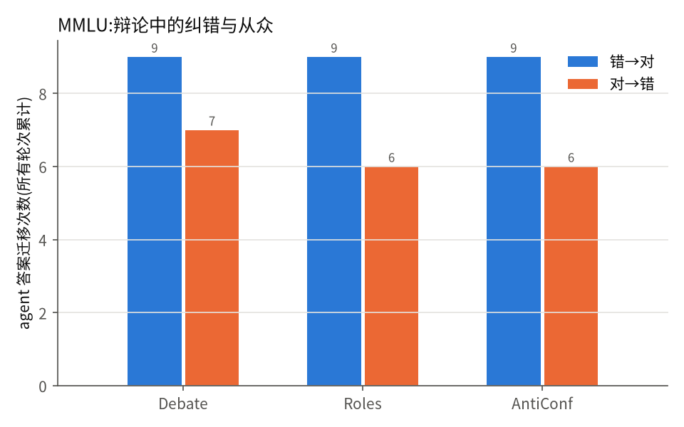
